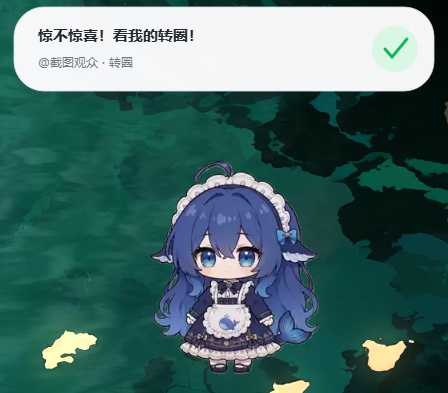

# 弹幕小人 MVP

一个本地运行的「弹幕 / 输入驱动虚拟小人」最小闭环：手动输入或模拟弹幕进来，DeepSeek 产出结构化动作，桌面小人边说边演。

```text
输入归一化 Event  ->  LLM 结构化决策 ActionPlan  ->  小人执行层 perform()
manual / simulator     DeepSeek JSON / 礼物剧本         dsh-dafeiyu + EdgeTTS
```

- Python 3.11 + FastAPI + WebSocket，网页管理端即开即用
- DeepSeek 严格 JSON 决策，枚举校验 + 兜底；没有 Key 时明确降级为本地模拟
- 原生桌面小人（dsh-dafeiyu）+ EdgeTTS + pygame，动作时长与语音对齐
- 支持打包成便携版 exe（PyInstaller onedir，约 201 MB）
- 73 项 pytest 测试

> MIT 许可。第三方依赖与角色素材的许可见 [THIRD_PARTY_NOTICES.md](THIRD_PARTY_NOTICES.md)。

第一版不接真实抖音，用网页输入框和模拟弹幕循环代替。真实 Webcast 消息的适配边界已经单独放在 `inputs/douyin_webcast.py`，未来只改这一层。



> 上图是实际运行截图：自定义回复气泡、`@截图观众 · 转圈` 和动作状态都来自本项目发送给 dafeiyu helper 的协议消息。

---

## 1. 已实现内容

- 统一事件：`source / user / text / gift_name / gift_count / timestamp`
- 手动输入、模拟弹幕循环、礼物快速测试
- 自动回复开关：默认关闭；关闭时新弹幕进入“待回复”列表，开启后先念弹幕再回复
- 角色语气管理：角色名、身份、语气、口头禅、回复长度、emoji、补充规则
- DeepSeek `deepseek-chat` 严格 JSON 决策
- 枚举校验与安全回退：非法 motion -> `idle` / `nod`，非法 emotion -> `neutral`
- 最近 10 轮上下文
- 礼物事件绕过 LLM，直接走高优先级预设剧本
- 3 秒过期丢弃、队列上限、礼物清空普通队列并打断当前表演
- EdgeTTS 合成 + pygame 播放，动作时长 = `max(动作最短时长, 语音时长 + 300ms)`
- dsh-dafeiyu 原生桌面窗口，始终置顶，复用其 16 组动画资产
- 浏览器控制台：输入、礼物、模拟循环、事件流、JSON 查看、角色预览
- 启动监听成功后自动打开默认浏览器（以服务端收到 `/` 请求为准）；`--no-browser` 可关闭，`--check-browser` 可查看启动环境
- 网页管理端：配置 DeepSeek Key / 模式 / 模型 / Base URL，保存到工作区 `.env` 并热切换
- 主动回复：全局“回复上一条”，以及时间线里每条弹幕的“回复这条”
- 73 项自动化测试通过；原生窗口、TTS、HTTP、WebSocket 均已实机跑通，便携版 exe 已打包验证

---

## 2. 快速开始

### 2.1 环境约定

项目使用**工作区内的独立 conda 前缀**，不依赖全局 Python，也不需要 `conda activate`；所有命令都通过项目解释器 `.\.conda\env\python.exe` 执行。

```text
conda 前缀:  ./.conda/env
Python:      3.11
解释器:      .\.conda\env\python.exe
```

依赖、缓存、临时文件和下载素材全部落在工作区内：`.conda/`、`.cache/`（pip/npm/conda 缓存）、`vendor/`（桌面小人素材）、`temp/`、`assets/`。唯一的外部前提是本机已安装 conda 与 Node（`npm` 仅用于 `npm pack` 下载素材，不装全局包）。

### 2.2 配 DeepSeek Key

```powershell
Copy-Item .env.example .env
notepad .env
```

至少填写：

```dotenv
DEEPSEEK_API_KEY=sk-...
LLM_MODE=auto
```

`LLM_MODE=auto` 的行为：

- 有 Key：真实调用 DeepSeek，控制台显示 `DeepSeek`
- 没有 Key：自动使用本地模拟决策，控制台明确显示 `本地模拟`，不会伪装成真实模型

Key 只保存在工作区 `.env`，不会写入日志，也不会被提交到 Git。

也可以启动后在网页右上角 **设置** 中填写 Key、模式和模型，保存后热切换，不需要手动编辑 `.env`。

> 管理端只监听 `127.0.0.1`，没有额外的登录鉴权；不要把 `APP_HOST` 改成 `0.0.0.0` 暴露到局域网。

### 2.3 启动

```powershell
# 推荐：项目脚本（会固定 TEMP/PIP_CACHE_DIR 到工作区）
powershell -NoProfile -ExecutionPolicy Bypass -File .\scripts\run.ps1

# 或者直接启动
.\.conda\env\python.exe -m danmaku_pet
```

启动后会自动用默认浏览器打开管理页面：

```text
http://127.0.0.1:8787/
```

打开方式与双击桌面快捷方式一致：把 URL 交给 Windows 自己的 Shell（`ShellExecute`），由系统默认浏览器接管。是否真的打开不靠窗口标题判断，而是看本地服务有没有收到 `/` 请求：

- 收到请求：控制台显示 `已在浏览器打开管理页面`。
- 浏览器进程起来了但页面还没请求：提示“浏览器已启动，但管理页面请求还没有到达”，此时不会继续弹新窗口。
- 完全没起来：按顺序继续尝试，最后逐条列出结果。

尝试顺序（每一步都按“服务端是否收到 `/` 请求”判断成功，失败才继续）：

1. 系统默认浏览器（`ShellExecute` / `os.startfile`）
2. `PowerShell Start-Process <url>`
3. 已安装浏览器的可执行文件（默认浏览器优先，其次 Edge 等备选）
4. 独立配置的浏览器窗口（`--user-data-dir` 指到 `temp/browser-profile`，绕过被占用/跨权限的默认配置）
5. `cmd start`

每一步如果启动后立刻退出，会把**退出码和浏览器自己的报错**一并打印出来（例如 Chrome 的 `crash server failed to launch`、`Failed to create a ProcessSingleton`），这比“未能打开”有用得多。浏览器子进程拿到的是系统默认 `TEMP/TMP`（不是 `run.ps1` 指到工作区的那份）。

自动打开失败时做一次启动测试：

```powershell
powershell -NoProfile -ExecutionPolicy Bypass -File .\scripts\run.ps1 --check-browser
```

它会打印默认浏览器、会话/桌面、完整性级别、进程是否受限、正在运行的浏览器及其权限级别，并实际尝试启动记事本、带临时配置的浏览器和带当前配置的浏览器，最后给出一句结论（当前会话禁止启动图形程序 / 浏览器启动后立即退出 / 浏览器其实能启动）。把这段输出贴出来即可定位。

**不需要管理员权限**：普通用户本来就能打开浏览器。反过来的情况才会出问题——如果 Chrome 是以管理员身份运行的、而本项目不是（或相反），Windows 会把两者隔开，自动打开会静默失败；这时要么用同一种权限启动，要么用上面的“独立配置”兜底。也可以手动访问上面的地址，或用 `--no-browser` 关闭自动打开。

### 2.3.1 启动器不弹窗时

`--check-browser` 的 `完整性级别` 是排查的第一行：

- **中**：正常。浏览器起不来就多半是 Chrome 配置被占用或安全软件，看「启动测试」里的退出码。
- **低 / 不可信**：这个终端是受限的（例如从沙箱、自动化工具或受限令牌的 shell 里启动）。Windows 的强制完整性控制会拒绝这种进程写「中等」标记的文件，而 Chrome 启动时必须写自己的配置目录，于是它一启动就退出（`0x80000003`，日志里是 `Crashpad\settings.dat: 拒绝访问 (0x5)`）。请从**开始菜单**新开一个 PowerShell / Windows Terminal 再运行；如果新窗口仍是「低」，就用「以管理员身份运行」打开终端（高完整性同样能写）。
- **高（管理员）**：可以写，但浏览器也会以管理员身份运行；如果平时已经用普通权限开着 Chrome，会撞上配置占用。

自查当前窗口的完整性级别：

```powershell
whoami /groups | findstr /i mandatory
```

显示 `Mandatory Label\Medium Mandatory Level` 才是普通交互式会话；显示 `Low Mandatory Level` 就是受限进程。

注意：**自动回复默认关闭**。手动输入框的“发送给小鱼”仍会立即回复；模拟弹幕循环产生的消息会先进入“待回复”列表。要让它自动念弹幕并回复，打开输入区上方的“自动回复弹幕”开关。

关闭桌面小人，只验证网页/TTS/队列：

```powershell
powershell -NoProfile -ExecutionPolicy Bypass -File .\scripts\run.ps1 --no-desktop
```

不自动打开浏览器：

```powershell
powershell -NoProfile -ExecutionPolicy Bypass -File .\scripts\run.ps1 --no-browser
```

强制本地模拟：

```powershell
powershell -NoProfile -ExecutionPolicy Bypass -File .\scripts\run.ps1 --mock
```

### 2.4 从零安装

```powershell
conda create -p ./.conda/env python=3.11 -y
powershell -NoProfile -ExecutionPolicy Bypass -File .\scripts\install.ps1
```

`install.ps1` 会：

1. 检查/创建 `./.conda/env`（若标准 conda 因 ToS 插件失败，会重试 `--no-plugins --solver classic`）
2. 用项目解释器执行 `scripts/pip_workspace.py install -r requirements.txt`
3. 用 `npm.cmd pack` 把 `dsh-dafeiyu@0.1.21` 下载到 `./vendor/` 并解压
4. 运行 `scripts/verify_install.py` 验证所有路径

> 本机 PowerShell 执行策略可能禁止 `.ps1`。上面的 `-ExecutionPolicy Bypass` 只作用于当前进程，不修改系统策略。

### 2.5 打包成 exe（便携版）

```powershell
# 打包（首次会自动把 PyInstaller 装进项目环境）
powershell -NoProfile -ExecutionPolicy Bypass -File .\scripts\build_exe.ps1 -Clean

# 打包并压成可分发的 zip
powershell -NoProfile -ExecutionPolicy Bypass -File .\scripts\build_exe.ps1 -Clean -Zip
```

产物：

```text
dist/DanmakuPet/
├─ DanmakuPet.exe        双击即启动（控制台窗口里能看到日志和地址）
├─ _internal/            运行时、PySide6、网页、桌宠素材
├─ .env.example          配置样例
└─ （首次运行生成）.env / data/ / assets/ / temp/ / .cache/
```

- 整个 `dist/DanmakuPet` 文件夹就是绿色版，拷到任何目录都能用；删除即卸载，不写注册表。
- 首次运行会在 exe 旁边生成 `data/persona.json`（从内置默认复制）、`assets/tts_cache/`、`temp/`、`.cache/`。DeepSeek Key 可以在网页右上角 **设置** 里填，会写进同目录的 `.env`，下次启动生效。
- 打包内容只包含运行时需要的东西：`danmaku_pet/web`、内置人设、`vendor/dafeiyu/package/runtime/*.py` 与 `assets/`；`vendor` 里的文档、`node_modules`、`native/`，以及 `runtime/bin`（上游附带的 174 MB 预编译 helper）都不会进包。
- 体积约 201 MB（PySide6 约 93 MB + 桌宠素材约 55 MB + 其余运行时），启动约 2–4 秒。
- 构建配置在 [`packaging/DanmakuPet.spec`](packaging/DanmakuPet.spec)，入口是 [`packaging/launcher.py`](packaging/launcher.py)。
- 桌宠在打包后不是子脚本而是**同一个 exe 以 `--run-dafeiyu-helper` 重入**运行（`danmaku_pet/paths.py` 把只读资源指向 `_internal`，可写目录指向 exe 所在文件夹）。
- exe 同样受「完整性级别」影响（见 2.3.1）：从开始菜单双击/普通窗口运行时是「中」，浏览器能正常弹出；如果从受限终端启动，浏览器仍会被 Windows 拦下。

> 打包需要写 `dist/`、`build/` 和项目的 `.cache/pip`，都在工作区内，不会装到全局 Python。

---

## 3. 项目结构

```text
douyin-live/
├─ danmaku_pet/
│  ├─ __main__.py              CLI 入口：--mock / --no-desktop / --no-browser / --check
│  ├─ server.py                FastAPI、REST、WebSocket、静态资源
│  ├─ config.py                工作区内路径、环境变量、运行配置
│  ├─ paths.py                 源码运行 / 打包运行的路径锚点（只读资源 vs 可写目录）
│  ├─ browser.py               打开管理页面、完整性级别诊断
│  ├─ models.py                Event / ActionPlan / AudioClip / VisualCue
│  ├─ queueing.py              异步队列、3 秒过期、礼物抢占
│  ├─ orchestrator.py          三段式编排：决策 -> TTS -> perform
│  ├─ settings_store.py        工作区 .env 的安全写入
│  ├─ persona.py               角色语气配置、加载与保存
│  ├─ broadcaster.py           WebSocket 广播
│  ├─ logging_setup.py         控制台 + temp/logs/app.log
│  ├─ inputs/
│  │  ├─ manual.py             手动输入 -> Event
│  │  ├─ simulator.py          模拟弹幕循环 -> Event
│  │  └─ douyin_webcast.py     未来 WebcastChat/Gift 的唯一适配边界
│  ├─ decision/
│  │  ├─ prompts.py            严格 JSON 系统提示词
│  │  ├─ llm.py                DeepSeek 客户端 + 本地模拟引擎
│  │  ├─ validator.py          枚举校验、兜底、字段清洗
│  │  ├─ context.py            最近 10 轮上下文
│  │  └─ gifts.py              礼物预设剧本
│  ├─ execution/
│  │  ├─ action_adapter.py     Motion -> dafeiyu 状态 / 浏览器动作映射表
│  │  ├─ dafeiyu.py            原生 helper 子进程 + stdin JSON 协议
│  │  ├─ backend.py            perform()：原生窗口 + 音频 + WebSocket
│  │  └─ tts.py                EdgeTTS 合成、缓存、pygame 播放
│  └─ web/                     index.html / styles.css / app.js
├─ tests/                      73 项单元与编排测试
├─ packaging/
│  ├─ DanmakuPet.spec          PyInstaller 打包配置（onedir）
│  └─ launcher.py              打包后的入口
├─ scripts/
│  ├─ install.ps1              从零安装
│  ├─ run.ps1                  本地启动
│  ├─ build_exe.ps1            打包成便携版 exe
│  ├─ fetch_visual.ps1         本地下载 dafeiyu 包
│  ├─ apply_dafeiyu_spin_patch.py 给本地 helper 加 spin effect
│  ├─ pip_workspace.py         工作区兼容的 pip 临时目录启动器
│  ├─ verify_install.py        安装位置验证
│  ├─ ws_smoke.py              WebSocket 冒烟测试
│  └─ capture_pet_window.ps1   只截取 dafeiyu 窗口的验证脚本
├─ vendor/dafeiyu/package/     dsh-dafeiyu@0.1.21 本地包（install.ps1 下载，不入库）
├─ assets/tts_cache/           EdgeTTS 音频缓存（不入库）
├─ data/persona.json           可编辑的角色语气配置（不入库）
├─ temp/                       日志、布局、临时文件、测试产物（不入库）
├─ docs/screenshots/           截图
├─ .conda/env/                 项目专属 conda 前缀环境（不入库）
├─ .cache/                     pip / npm / conda / LOCALAPPDATA 缓存（不入库）
├─ LICENSE                     MIT
├─ THIRD_PARTY_NOTICES.md      依赖与素材许可声明
├─ .env.example
├─ requirements.txt
└─ pytest.ini
```

---

## 4. 模块职责与数据流

### 4.1 输入层

`inputs/` 只负责把外部来源变成 `Event`，不碰 LLM，也不碰画面。

```python
Event(
    source="manual" | "danmaku_sim" | "gift_sim",
    user="观众昵称",
    text="弹幕内容",
    gift_name=None,
    gift_count=0,
    timestamp=time.time(),
)
```

未来替换成抖音官方消息时：

```python
# inputs/douyin_webcast.py
chat_event  = adapter.from_webcast_chat(WebcastChatMessage)
gift_event  = adapter.from_webcast_gift(WebcastGiftMessage)
```

下游只消费 `Event`，完全不需要改动。

### 4.2 决策层

普通弹幕：

```text
Event + 最近 10 轮上下文
  -> DeepSeek /chat/completions
  -> response_format={"type":"json_object"}
  -> 解析 JSON
  -> 枚举校验 / 兜底
  -> ActionPlan
```

`ActionPlan` 严格字段：

```json
{
  "reply": "不超过 60 个汉字的一句话",
  "emotion": "happy | sad | surprised | shy | angry | neutral",
  "motion": "idle | nod | wave | jump | spin | shake_head | shy | sad | surprised",
  "priority": "normal | high",
  "interrupt": false
}
```

校验规则：

| 情况 | 处理 |
| --- | --- |
| 非法 `motion` | 正向/中性情绪回退 `nod`，其余回退 `idle` |
| 非法 `emotion` | `neutral` |
| 非法 `priority` | 普通事件 `normal`，礼物强制 `high` |
| 礼物 `interrupt=false` | 强制 `true`，保证礼物能抢占 |
| `reply` 为空 | 使用兜底回复 |
| JSON 解析失败 | 使用兜底 `ActionPlan`，事件不崩 |
| DeepSeek 网络失败 | 兜底 `ActionPlan` + UI warning，不阻塞队列 |

礼物事件不调用 LLM：

```text
嘉年华 -> surprised / spin / high / interrupt
火箭   -> surprised / jump / high / interrupt
跑车   -> happy / spin / high / interrupt
玫瑰   -> shy / shy / high / interrupt
...
未知礼物 -> happy / wave / high / interrupt
```

### 4.3 执行层

`Orchestrator._process()` 的顺序：

1. `decide()` 得到 `ActionPlan`
2. `EdgeTTSService.synthesize(reply)` 生成或复用 MP3
3. `AudioPlayer.measure()` 得到真实音频时长
4. `ActionAdapter.build_cue(plan, audio_ms)` 生成 `VisualCue`
5. `PerformanceBackend.perform(plan, event, audio, cue)`
   - 发送 `visual` / `performance` 给浏览器
   - 向 dafeiyu 发送 `pulse` 或 `state`
   - 播放音频
   - 等待 `cue.hold_ms`
   - 发送 `state IDLE`
6. 成功完成后写入上下文

关键时序：

```text
hold_ms = max(mapping.min_hold_ms, speech_ms + 300)
```

所以动作不会在语音结束前结束。TTS 失败时用文本长度估算时长，仍然保持动作与“静音语音”的协调。

### 4.4 网页管理端与主动回复

右上角“设置”打开管理端：

- 选择 `auto / deepseek / mock`
- 填写或替换 DeepSeek API Key
- 修改模型、Base URL
- 保存后写入工作区 `.env`，并热切换决策引擎，不需要重启服务
- Key 是只写字段：任何 API 都不返回 Key，页面只显示“已配置/未配置”
- 如果当前正好有一次 DeepSeek 请求在途，保存会等它结束后再切换

“角色语气”页签可以配置：

- 角色名
- 身份设定
- 语气风格
- 口头禅 / 说话习惯
- 回复长度：短句 / 适中 / 稍长
- 是否允许少量 emoji
- 补充规则

保存调用 `POST /api/settings/persona`，写入 `data/persona.json`，并重新构建系统提示词、热切换决策引擎。  
角色设定只影响回复内容和语气，系统提示词会明确禁止它改变 JSON 字段和 `motion/emotion` 枚举。  
本地模拟模式只简单使用角色名；完整语气效果需要真实 DeepSeek 模式。

主动回复有两个入口：

- 输入区“回复上一条”：重新走完整三段式流程，回复最近一条普通弹幕
- 时间线每条弹幕的“回复这条”：指定某条旧弹幕再次回复

它们不是回放旧 `ActionPlan`，而是用新的 `Event` 重新调用决策层、重新生成 TTS 和动作，因此会带上当前 10 轮上下文。

所有弹幕默认**不会自动回复**：模拟/真实弹幕会进入“待回复”列表，不调用 LLM，也不播放 TTS。  
打开输入区上方的“自动回复弹幕”开关后，新弹幕会先被念出来，再执行回复。  
“回复上一条/回复这条”始终可用，用于手动处理待回复弹幕或再次回复旧弹幕。

补充语义：

- 开关状态写入 `.env` 的 `AUTO_REPLY`，默认 `false`
- 关闭时进入 `pending` 收件箱（最多 30 条），**不受 3 秒过期影响**，等待人工处理
- 开启时 `ingest()` 直接把事件以 `read_aloud=True` 入队
- 手动输入框的“发送给小鱼”是显式操作，始终立即处理，不受开关影响；是否朗读弹幕由开关决定
- 礼物不吃这个开关，始终走 high priority 剧本并抢占
- 开启自动回复时 TTS 文本是：`{user}说：{弹幕}。{回复}`，音频时长会进入动作 `hold_ms` 计算

---

## 5. 动作映射表

dafeiyu 的原生协议只接受状态/脉冲，不接受任意 clip 名，因此适配器必须做“最近动作”映射。映射表在 `execution/action_adapter.py` 的 `MOTION_MAP` 中，也是未来替换 Live2D 时唯一需要重写的数据。

| 我们的 motion | dafeiyu 原生状态 | 原生动作说明 | 浏览器预览片段 | 浏览器附加变换 | 最短保持 |
| --- | --- | --- | --- | --- | --- |
| `idle` | `IDLE` / `WORKING` | 待机；说话时用 `WORKING` 循环作为说话动画 | `idle` | 无 | 600ms |
| `nod` | `SUCCESS` pulse | 用 success 片段代替点头 | `success[0:56]` | bob | 1600ms |
| `wave` | `SUCCESS` pulse | 用 head_pat 抬手片段代替挥手 | `head_pat[0:64]` | sway | 2200ms |
| `jump` | `SUCCESS` pulse | 用 success 腾跃片段 | `success[52:120]` | bounce | 2400ms |
| `spin` | `SUCCESS` pulse + `effect` | helper 本地扩展做左右 yaw 转身，网页预览同步横向转身 | `success[96:196]` | 横向 yaw | 3000ms |
| `shake_head` | `ERROR` pulse | 用 error 片段 + 抖动 | `error[0:64]` | shake | 2200ms |
| `shy` | `WAITING` pulse | 用 head_pat 低头片段 | `head_pat[56:140]` | tilt | 2400ms |
| `sad` | `ERROR` pulse | 用 error 低头片段 | `error[28:118]` | sink | 2800ms |
| `surprised` | `WAITING` pulse | 用 poke 受惊片段 | `poke[0:56]` | pop | 2000ms |

说明：

- 原生窗口是主视觉；浏览器预览同步观测动作。`spin` 在两端都做“左右转身”，不是屏幕平面内的翻跟头。
- dafeiyu 没有嘴巴/口型通道。说话期间保持动作状态 + `WORKING` 循环 + 网页语音波形，这是 MVP 的“说话动画”替代方案。
- 原生 `pulse` 的完整 clip 可能长于语音，项目会在 `hold_ms` 后主动发 `IDLE`，因此动作不会拖尾，也不会早于语音结束。
- 如果以后换成 Live2D 或自定义模型，只需要新增一个实现 `perform(plan, event, audio, cue)` 的后端，并替换 `MOTION_MAP`，上游完全不动。

---

## 6. 为什么第一版优先 dsh-dafeiyu，而不是 dsh-bigfish

| 维度 | dsh-dafeiyu | dsh-bigfish |
| --- | --- | --- |
| 形态 | Windows 原生透明置顶窗口 | DSH Web 内 React/Canvas 宠物 |
| 动作入口 | 简单行协议 `state/pulse/task/config` | 绑定 DSH Session 事件，没有外部 `perform` |
| 接入 Python 的难度 | 低：可直接运行其 `runtime/helper.py` | 高：需要伪造/桥接 DSH Web 会话 |
| 动作数量 | 16 组 clip，够 MVP | 101 类动作，更丰富 |
| 本项目取舍 | **第一版选它**：桌面陪伴感强、协议简单、视觉与 Python 解耦 | 后续需要更丰富动作时的升级候选 |

关键结论：**bigfish 的动作集更好，但它的驱动入口是 DSH 会话状态，不是外部动作 API。** 为了让它响应 “spin”，需要额外写 DSH 插件/会话桥，超出 MVP 范围。dafeiyu 的协议虽然也只有状态级控制，但可以在 Python 进程里直接驱动，且原生窗口效果更接近“直播间虚拟小人”。

dafeiyu 本身没有动作级 API，所以本项目给它的本地 helper 加了一个很小的 `effect` 扩展：`spin` 时在 Qt 绘制层做横向 yaw（左右转身），不改变上游的 `state/pulse` 协议和动画资产。补丁脚本是 `scripts/apply_dafeiyu_spin_patch.py`，升级 dafeiyu 后需要重新执行一次。

另外，dafeiyu 官方 `.exe` 的 PyInstaller 自解压层在本工作区的临时目录下无法创建解压结构。为了不写系统临时目录，本项目直接运行 `runtime/helper.py`，并显式把 `TEMP/TMP/LOCALAPPDATA/布局文件` 指向工作区。视觉代码、资源和动画与插件一致。

---

## 7. 队列与打断语义

`EventQueue`：

- 普通事件 FIFO
- 队列上限 50
- 出队时检查 `timestamp`，超过 3 秒直接丢弃并广播 `dropped`
- 礼物事件：
  1. 先 `cancel()` 当前 `_process` 任务
  2. 停 TTS / 通知 dafeiyu 回 `IDLE`
  3. 清空队列中的普通事件
  4. 把礼物插到队首
  5. 礼物剧本立即执行

这保证“嘉年华”不会排在 20 条过期弹幕后面，也不会等当前 10 秒动作播完。

自动回复关闭时，普通弹幕不会进入 `EventQueue`，而是进入 `pending` 收件箱；手动点“回复”后才入队。因此 3 秒过期只作用于“已决定要自动处理”的队列，不会让待回复弹幕悄悄消失。

自动回复开启时，实测压测：

```text
15 条模拟消息，1 秒一条
-> completed 5
-> dropped 10
-> queue 0
```

---

## 8. API

| 方法 | 路径 | 作用 |
| --- | --- | --- |
| `GET` | `/` | 控制台 |
| `GET` | `/api/health` | 存活检查 |
| `GET` | `/api/status` | 配置、队列、统计、最近事件、后端状态 |
| `POST` | `/api/events/manual` | `{text,user}` 手动输入 |
| `POST` | `/api/events/gift` | `{gift_name,gift_count,user,text?}` 礼物测试 |
| `POST` | `/api/chat/reply` | `{event_id?,text?,user?}` 主动回复上一条/指定弹幕 |
| `POST` | `/api/settings/auto-reply` | `{enabled}` 开关自动回复（默认关闭，持久化到 `.env`） |
| `POST` | `/api/settings/persona` | 角色名/身份/语气/口头禅/长度/emoji/补充规则 |
| `POST` | `/api/settings/llm` | `{mode,api_key?,model?,base_url?,clear_key?}` 保存并热切换 LLM |
| `POST` | `/api/simulator/start` | `{interval_seconds,scenario}` 启动模拟循环 |
| `POST` | `/api/simulator/stop` | 停止模拟循环 |
| `POST` | `/api/interrupt` | 打断当前表演 |
| `POST` | `/api/context/clear` | 清空 10 轮上下文 |
| `GET` | `/api/actions` | 动作映射表 + 礼物剧本表 |
| `GET` | `/assets/pet-manifest.json` | dafeiyu 动画清单 |
| `GET` | `/assets/pet/...` | dafeiyu 动画帧 |
| `GET` | `/media/tts_cache/...` | 生成的 TTS 音频 |
| `WS` | `/ws` | 实时事件、决策、动作、状态 |

---

## 9. 测试

```powershell
.\.conda\env\python.exe -m pytest -q
```

当前结果：

```text
73 passed
```

覆盖：

- Event / ActionPlan 契约
- 非法枚举回退
- 礼物剧本与别名
- 10 轮上下文
- DeepSeek JSON 解析、`response_format` 重试、HTTP 错误
- 3 秒过期、队列上限、礼物抢占
- 9 种 motion 的映射
- 动作不早于语音结束
- EdgeTTS 缓存与失败降级
- Orchestrator 串行处理 / 完成 / 中断
- 自动回复默认关闭、待回复收件箱、手动回复移除待回复
- 自动模式先念弹幕再回复
- 角色语气配置、提示词注入与 JSON 契约保持
- 管理端 `.env` 写入、主动回复上一条/指定弹幕
- Douyin Webcast 字段映射
- 打开浏览器：成功/失败/进程起来但页面未请求、启动器降级
- 打包路径锚点：只读资源与可写目录分离

---

## 10. 运行位置

所有依赖与产物都在工作区内，`scripts/verify_install.py` 会逐项检查：

```text
Python              <工作区>\.conda\env\python.exe
conda 前缀           <工作区>\.conda\env
site-packages       <工作区>\.conda\env\Lib\site-packages
dafeiyu 素材         <工作区>\vendor\dafeiyu\package
TTS 缓存            <工作区>\assets\tts_cache
pip / npm / conda 缓存 <工作区>\.cache
临时文件 / 日志       <工作区>\temp\（日志在 temp\logs\app.log）
便携版产物           <工作区>\dist\DanmakuPet\
```

- 没有创建 `.venv`，没有使用全局 Python，没有 `pip install --user`，没有 `npm install -g`
- `npm pack` 只用于把 `dsh-dafeiyu` 下载到 `vendor/`，缓存放在 `.cache/npm`
- `verify_install.py` 会校验全部 Python distribution 都位于项目 conda 前缀，并运行 `pip check`


---

## 11. 已知限制 / 下一步

1. **还没有接真实抖音**：`inputs/douyin_webcast.py` 是唯一预留适配器，实际 Webcast 长连接、签名、心跳尚未接入。
2. **DeepSeek Key**：可在网页右上角“设置”中填写，也可写 `.env`；没有 Key 时使用明确标注的本地模拟。
3. **dafeiyu 的动作集不等于自定义枚举**：`spin` 通过本地 helper `effect` 做左右 yaw；`jump` 等仍通过状态/片段做最近动作映射。没有真实口型；需要完整骨骼/口型时换 Live2D 或自定义渲染器，接口已隔离。
4. **TTS 依赖网络**：EdgeTTS 失败会自动降级为静音动作，不阻塞队列。
5. **浏览器预览不是主视觉**：原生 dafeiyu 窗口才是；网页用于操作、观测和补充动作效果。
6. **模型输出仍是概率性的**：已用 `response_format=json_object` + 提示词 + 枚举校验 + 兜底，但无法保证 100% 语义正确。

---

## 12. 关键代码入口

- 三段式编排：[`danmaku_pet/orchestrator.py`](danmaku_pet/orchestrator.py)
- 队列与抢占：[`danmaku_pet/queueing.py`](danmaku_pet/queueing.py)
- DeepSeek 客户端：[`danmaku_pet/decision/llm.py`](danmaku_pet/decision/llm.py)
- JSON 校验：[`danmaku_pet/decision/validator.py`](danmaku_pet/decision/validator.py)
- 礼物剧本：[`danmaku_pet/decision/gifts.py`](danmaku_pet/decision/gifts.py)
- 动作映射：[`danmaku_pet/execution/action_adapter.py`](danmaku_pet/execution/action_adapter.py)
- dafeiyu 协议：[`danmaku_pet/execution/dafeiyu.py`](danmaku_pet/execution/dafeiyu.py)
- 执行器：[`danmaku_pet/execution/backend.py`](danmaku_pet/execution/backend.py)
- EdgeTTS：[`danmaku_pet/execution/tts.py`](danmaku_pet/execution/tts.py)
- Web 控制台：[`danmaku_pet/web/index.html`](danmaku_pet/web/index.html)

---

## 13. 许可证

本项目代码以 **MIT** 许可发布，见 [LICENSE](LICENSE)。

运行时依赖与桌面小人素材的许可情况（含 PySide6 / edge-tts / pygame 的 LGPL 要求）见 [THIRD_PARTY_NOTICES.md](THIRD_PARTY_NOTICES.md)。

仓库里**不含**以下内容，克隆后按「2.4 从零安装」重建即可：

| 内容 | 原因 | 如何获得 |
| --- | --- | --- |
| `vendor/dafeiyu/`（约 231 MB） | 上游 npm 包与角色素材，避免重复分发 | `scripts/install.ps1` / `scripts/fetch_visual.ps1` |
| `.env` | 含个人 API Key | 从 `.env.example` 复制 |
| `.conda/`（约 877 MB） | 本机环境 | `conda create -p ./.conda/env python=3.11 -y` + `install.ps1` |
| `dist/`（约 201 MB） | 打包产物 | `scripts/build_exe.ps1` |
| `temp/`、`assets/tts_cache/` | 运行产物与日志 | 首次运行自动生成 |

如果你要二次分发便携版 exe，请同时遵守 [THIRD_PARTY_NOTICES.md](THIRD_PARTY_NOTICES.md) 里对 LGPL 组件与角色素材的说明。


